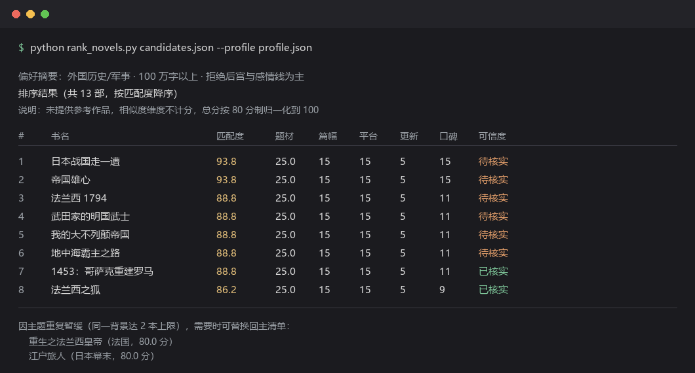

# novel-recommender

> 让 AI 按你的口味挑中文网络小说，并且告诉你每本书有什么坑。

一个给 AI Agent 用的 Skill（技能包），WorkBuddy / Claude Code / Codex 都能加载。

## 为什么要做这个

你问 AI"推荐几本小说"，拿回来的多半是搜索结果的重排：几本反复出现的爆款，没有出处，不知道还在不在架，也分不清是读者在夸还是营销号在吹。

更烦的是踩雷。说好不要系统流，推过来三本系统流；说好别推读过的，第一本你早读完了。

这个 skill 的做法是把"找小说"拆成五步：问清口味、四个平台各搜一轮、按你的雷点硬性排除、六维打分排序、最后给每本书标清楚哪条信息核实过、哪条要你自己再看一眼。

## 和直接问 AI 的区别

| | 直接问 AI | 用这个 skill |
|---|---|---|
| 偏好收集 | 随口问两句就开找 | 分 3 轮问，含雷点勾选和已读去重 |
| 检索范围 | 想到哪搜到哪 | 起点、番茄、晋江、七猫，四个平台各搜一轮 |
| 排序依据 | 模型凭感觉 | 六维加权，脚本算，同样输入给同样结果 |
| 舆论判断 | "这本书很受欢迎" | 分清「口味分歧」和「质量硬伤」，剔掉营销号通稿 |
| 信息可信度 | 不区分 | 四档标注：已核实 / 待核实 / 信息不全 / 来源不明 |
| 不满意怎么办 | 重新问一遍 | 只改该动的那一项 |

## 输出长什么样

打分脚本跑出来的排序表。每本书带六维分数和可信度，底部是撞了"同一背景最多 3 本"这条规则、被暂缓的候选：



## 它是怎么做的

下面五段的顺序就是执行顺序。

**先问，问得够细。** 首轮固定 6 项：题材、结构偏好、当前状态、篇幅、雷点、已读去重。题材之外一定要问结构偏好——"要玄幻"背后真正在意的，往往是"不要系统流"。二轮看情况再追问，不会一次抛十几个问题把人问烦。

**再搜，四个平台一个不漏。** 起点、番茄、晋江、七猫，正好覆盖男频女频乘付费免费的四种组合。检索词强制带平台名前缀，不然中文网文的结果会被起点系内容淹掉，剩下三个平台等于没搜。

**然后筛。** 四道过滤里，已读去重和雷点靠语义判断，得人工标；篇幅超区间、只有实体书的，规则明确，脚本自动剔。别指望后者靠人记。

**接着排。** 六维打分：题材 30 分、相似度 20、篇幅 15、平台 15、舆论 15、更新状态 5。舆论那 15 分分六档，从"多来源正面且讨论量大"一直排到"负面为主"，中间还要拆开两极分化——争议落在口味上（节奏慢、文风冷）和落在硬伤上（烂尾、注水）不是一回事，差 4 分，输出时的措辞也该不同。

打完分还有两道后处理：同名合并（《从太空垃圾佬开始》和《我是太空垃圾佬》是同一本），主题分散（同一背景最多留 3 本，免得 13 本里 5 本都是日本战国）。

**不满意就说，五类说法对应五条路。** 换范围、换口味、单本否决、整体不满、随口追问，各自只动需要动的那部分，不用把需求重说一遍。上限 3 轮，第 4 轮开始强制回到一个问题：是不是偏好本身还没搞清楚。

## 安装

把整个 `novel-recommender` 文件夹放进对应工具的 skills 目录：

| 工具 | 安装位置 |
|---|---|
| WorkBuddy | `~/.workbuddy/skills/novel-recommender/` |
| Claude Code | `~/.claude/skills/novel-recommender/` |
| Codex | `$CODEX_HOME/skills/novel-recommender/` |

或用 Git 直接克隆：

```bash
git clone https://github.com/xoox911/novel-recommender.git ~/.workbuddy/skills/novel-recommender
```

也可以从 [Releases](../../releases) 下载 zip 解压。

装完无需配置。下次对话里说"书荒了"或"帮我找本小说"就会触发。

### 不想碰终端：让 AI 自己装

上面这些步骤也可以交给 AI 做。在支持 Skill 的工具对话框里，一句话说清要装什么，剩下的下载、放到正确目录、确认 `SKILL.md` 能加载，它自己会完成。

**适用前提**（三条同时满足才行）：

- 客户端有本地文件系统读写权限，并且能执行命令——桌面端 Agent 一般两者都有，纯网页聊天窗口通常都没有
- 当前会话能联网（访问 GitHub 或内置技能市场）
- 目标工具支持 `SKILL.md` 规范（WorkBuddy / Claude Code / Codex）

**支持的安装对象**：

| 类型 | 举例 | 额外要求 |
|---|---|---|
| Git 仓库地址 | 本项目的 GitHub 链接，AI 会 clone 到对应 skills 目录 | 需要命令执行权限 |
| Releases zip 直链 | AI 下载后解压到同一位置 | 需要解压能力 |
| 技能市场里的 skill 名 | AI 走内置安装流程，不需要你提供路径 | 该 skill 在市场里可搜到 |

**装完应该看到什么**：AI 会回报三件事——装到了哪个绝对路径、`SKILL.md` 是否被识别、下一轮对话说什么能触发。不用重启，新开一轮对话直接提需求即可。装失败时，正常表现是它明确告诉你卡在哪（网络不通 / 无写权限 / 目标目录已有同名 skill），而不是丢一堆命令让你自己查。

**示例**（照抄即可）：

> 帮我把 https://github.com/xoox911/novel-recommender 装成 skill

装完发现没反应，别急着重装。让 AI 列出目标目录下的实际文件，先确认 `SKILL.md` 和 `scripts/` 都在位，比反复安装有效。

## 使用示例

**最简：**

> 书荒了，帮我找本小说

它会先问 6 个问题（可跳过任意一项），再出清单。

**带明确偏好：**

> 想看星际战舰类的，100 万字以上，不要有感情线

**换口味：**

> 换，这次看外国历史的

**拿到清单后：**

> 第 3 本我看过 / 第 2 本不合口味，太慢了 / 只要免费的 / 这几本都不对味

以上每种说法会走不同的修正路径，不需要重复完整需求。

## 打分模型

满分 100（无参考作品时按 80 分制归一化）：

| 维度 | 权重 | 说明 |
|---|---|---|
| 题材与标签契合 | 30 | 主类型命中 + 细分标签比例折算 |
| 与参考作品相似度 | 20 | 仅在用户给了参考作品时启用 |
| 篇幅契合 | 15 | 目标区间内满分，区间外 30% 内 8 分 |
| 平台可及性 | 15 | 主用平台可直接读满分，需换平台减半 |
| 舆论质量 | 15 | 六档制，详见 `references/source-credibility.md` |
| 更新状态匹配 | 5 | 完结 / 连载 |

打分由 `scripts/rank_novels.py` 执行，不靠模型心算。同一份输入每次输出一致。

```bash
# 先校验输入，再排序（推荐）
python "<skill_dir>/scripts/rank_novels.py" ./novel-candidates.json --profile ./novel-profile.json --check
python "<skill_dir>/scripts/rank_novels.py" ./novel-candidates.json --profile ./novel-profile.json
```

`<skill_dir>` 换成 skill 装在哪（如 `~/.workbuddy/skills/novel-recommender`）。**别用相对路径**——你的当前目录通常不是 skill 目录，直接写 `scripts/rank_novels.py` 会报找不到文件。

脚本会校验所有字段类型与枚举值，写错时报错退出并指明具体是哪一部候选的哪个字段，不会静默按 0 分处理。篇幅超区间和纯实体/已下架的作品由脚本自动剔出主榜（分别列入「篇幅超区间」和「延伸参考」），不需要手工标记。

## 目录结构

```
novel-recommender/
├── SKILL.md                           六阶段主流程 + 多轮修正协议
├── CONTRIBUTING.md                    改代码、跑测试、发版
├── references/
│   ├── preference-taxonomy.md         题材标签体系、雷点清单、篇幅分档
│   ├── platform-guide.md              四平台必检规则、检索词构造
│   ├── source-credibility.md          四档可信度、营销号识别、争议分类
│   └── output-template.md             输出模板与脚本 JSON 格式
├── scripts/
│   └── rank_novels.py                 加权打分、同名合并、主题分散、硬过滤
└── tests/
    └── test_rank_novels.py            33 个回归用例，标准库 unittest
```

## 兼容性

`SKILL.md` 的 frontmatter 只有 `name` / `description` / `agent_created` 三个字段。`agent_created` 是 WorkBuddy 写入的标记，其他工具会忽略，不影响加载。已在 WorkBuddy 上实测。

**运行要求**：Python 3.10+，**零第三方依赖**（只用标准库）。不需要 pip install 任何东西。

自带 33 个回归用例，覆盖打分模型、字段校验、别名合并、主题分散和各类异常输入。要改代码、跑测试或者自己发版，看 [CONTRIBUTING.md](CONTRIBUTING.md)。

## 已知局限

- **得联网才能用**。搜索不可用时会降级，全部标「待核实」并告知用户，不会编造。
- **只覆盖 4 个必检平台**。掌阅、书旗、咪咕等未纳入常规检索，只在查特定书时兜底。
- **舆论判断有主观成分**。六档分档由执行者判定，不是算法结果；同一本书不同人可能判到相邻两档。
- **部分链接要你自己点一下**。标「待核实」的作品，字数与状态来自二手来源，没逐个打开作品页。
- **中文描述才稳**。用英文提问时，触发率可能偏低。

## 合规

本 skill 只提供正版阅读渠道，**不检索、不提供、不暗示任何盗版站点、破解资源、网盘分享或 TXT 下载渠道**。不绕过任何付费墙、验证码或访问控制。

推荐结果中的书籍信息版权归原作者与平台所有。

## License

MIT
